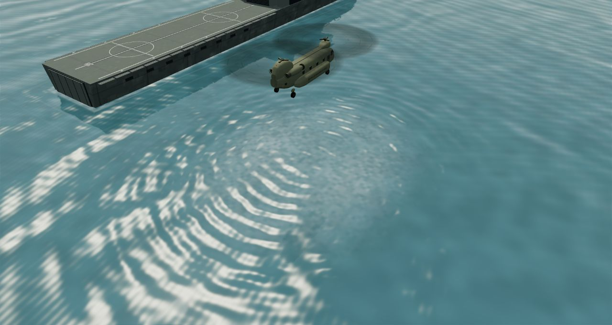
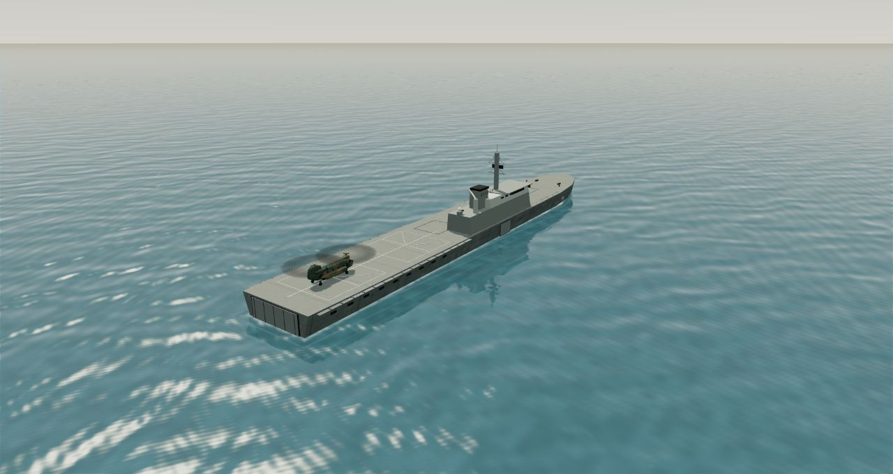
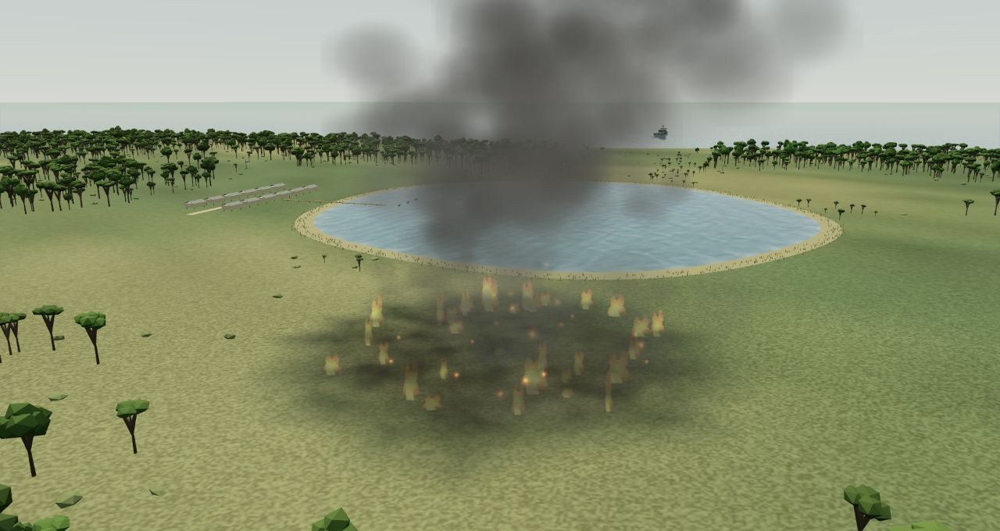

# Water, ships and atmosphere — 9 October 2026

Water now uses a 512 × 512 planar scene reflection for the active sea or lake, refreshed at most once per 80 ms, with continuous wave-normal animation between captures. Fresnel reflection, sun glints and wind-driven irregular wave bands replace the earlier solid surfaces. Subpixel waves fade to prevent distant shimmer. Sea and freshwater retain their existing collision and pickup elevations. Rivers use the same lighting without another reflection pass.

Twin downwash areas follow the rotor positions and fade with altitude; the ship deck intercepts downwash while the aircraft is on it. Bucket contact adds local lake ripples. Both ships remain stationary gameplay platforms, so their waterline disturbance is a restrained wave/foam band rather than a high-speed wake. Small lake boats bob subtly.

RSS Persistence and JS Kunisaki were refined against the ship-specific photographs and official drawings recorded in [ship references](ship-geometry-references.md). Their hull shoulders, bridge/island rake, glazing, fittings, paint variation and waterline were refined while preserving marked deck positions and clearance. Surface seams and weathering are authored visual approximations, not copied photographs or surveyed plates.

Fire now uses four instanced particle draws for flames, rising and low drifting smoke, embers, and steam as heat falls. Smaller flames and feathered, mottled burn scars keep the fire grounded. Wind carries the plume and cloud layers; entering the downwind plume adds gentle local haze, which clears as the fire is suppressed. The visible sun and directional light agree, and the shadow camera follows the aircraft.

## Visual checks

The images below are from temporary fixed camera views of the real rendering modules. Both normal campaign launch views were separately checked; the final production JGSDF scene had no new console warnings or errors. The 41 simulation/content tests and production build passed. Sustained physical-phone performance remains unmeasured.

## Flight feel and altitude — 10 October 2026

Ground-layer haze now integrates an exponentially thinning atmosphere along the view ray. It uses the current atmospheric fog colour, including local smoke tint, while keeping the foreground clear. Shader hooks compose with instanced fire and burn-scar materials; no extra render pass is required. Ray length is calculated per fragment to avoid excessive fog on nearby parts of the large sea plane. The chase view also widens gradually by up to three degrees between 80 and 320 metres above terrain, revealing more ground as the aircraft climbs.

Taut-sling damping now acts on tangential velocity relative to the moving hook. Inward velocity, slack, gravity, surface contact, and the 22-metre length constraint remain active. Empty and loaded acceleration/reversal regressions check settling and clearance. Virtual joysticks use a 6.5% radial deadzone and smooth response, with maximum yaw/cyclic/collective commands of 68%/78%/86%; the knob still follows the pointer directly and release immediately clears the commands.

## Close-range material refinement — 12 October 2026

Ground albedo and relief have slightly more definition at working altitude, using the existing packed atlas and habitat noise. The extra medium-scale variation fades with distance; height fog, terrain geometry, collision heights and the immutable burn field remain unchanged. Painted aircraft surfaces use a slightly broader environment response and stronger local occlusion to reveal fuselage curvature without changing livery colours, geometry or lighting presets. No new textures or render passes are added.

These adjustments are visual tuning, not evidence of higher physical-device frame rates. Phone thermal and GPU acceptance still follows [graphics quality](graphics-quality.md).

## Flight interface and surface effects — 12 October 2026

The application owns a single flight/map/pause state. The tactical map pauses the sortie, hides flight controls and traps focus; M and Escape share the same transitions as the buttons. Pause includes a compact keyboard reference. Larger HUD labels and guidance-aligned messages leave the aircraft and sling clearer.

Mission briefings show the goal before the map on phones, keep launch outside bounded scrolling content, and support expanding the complete terrain map. Resume labels include the checkpoint phase and elapsed time, using the same eligibility rules as mission selection; saves from older world revisions still undergo position validation at launch.

Flame cards remain upright and sample their moving bases against terrain, with irregular feathered contact edges. Freshwater has quieter waves and reflection distortion while rotor wash, bucket ripples and sea motion remain active. Paused planar reflections reuse their image until the camera, scene, texture, quality or viewport changes. Late ground-atlas loads explicitly invalidate the reflection cache.

Verification: 278 tests across 53 files passed, including all twelve mission integrations. Browser checks covered 1440×900, 1280×720, 390×844 and 844×390 layouts, launch/resume, campaign switching, map/pause shortcuts and focus, plus fire, lake and night fixtures in both campaigns. These checks do not establish physical-phone performance.
